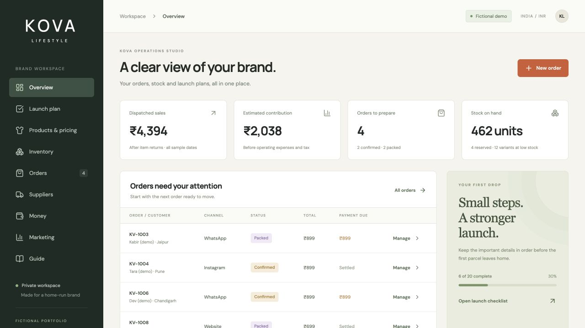

# Kova Lifestyle — Operations Studio

A fictional Indian T-shirt brand and a working operations app for a business run from home. Currency: INR. Every starting customer, supplier, stock quantity and sales record is invented.



## What works

- A 20-task launch checklist covering brand, products, suppliers, money, store setup, marketing and operations.
- A 60-variant starter catalogue: 2 styles × 2 fits × 3 colours × 5 sizes, with editable prices, reference unit costs and low-stock points.
- A price calculator using garment, printing, packaging, shipping, payment fees and target margin assumptions.
- Stock ledger showing physical, reserved and available units.
- Multi-item orders with prepaid or cash-on-delivery payments, packing, dispatch, delivery and cancellation.
- Manual customer payments, item returns and refunds, with limits that prevent duplicate returns or refunds beyond recorded funds.
- Suppliers, purchase orders, advances, balances and one-time whole-batch stock receipt.
- Operating expenses, sales by channel and estimated contribution before tax.
- Campaign planning, manual campaign results and a Google Ads search launch worksheet with a simple budget scenario.
- Stock and order CSV exports and a complete JSON data archive.
- Private, server-saved records for each signed-in account. Concurrent edits use revision checks.

## Try the complete workflow

1. Open **Products & pricing** and inspect a product's price and cost.
2. Open **Orders**, create a fictional order and choose a quantity within available stock.
3. Open **Inventory**. The order increases reserved stock but does not change physical stock.
4. Manage the order and record its payment if prepaid.
5. Mark it packed, then dispatch with a fictional courier reference and shipping cost.
6. Physical stock now falls and the reservation clears.
7. Mark it delivered, then record an item return and choose whether it can be resold.
8. Record a refund after the money has been sent outside the app.
9. Create and receive a supplier purchase to replenish stock.
10. Review **Money**, then export a data archive from **Guide**.

An exchange uses a return and a separate replacement order linked through the Related order field. Automatic credit transfers and one-click exchanges are not implemented.

## Rules and measures

- Available stock = physical stock − reservations for confirmed and packed orders.
- Dispatch removes physical stock. Cancellation releases reservations for unsent orders.
- Unit cost and selling price are copied into order lines, so later catalogue edits do not rewrite earlier order figures.
- Dispatched sales = shipped/delivered item value + customer shipping charges − returned item value.
- Estimated contribution = dispatched sales − saved unit costs − recorded shipping/packaging costs − estimated payment fees.
- Sellable returns reverse the saved unit cost. Damaged returns leave the cost in the estimate.
- Operating expenses are deducted separately. This is not a tax calculation, cash flow statement or formal accounting system.
- Fees use the order's saved percentage and gross order value. Refunds do not reverse assumed fees.
- Campaign tags are descriptive links, not proof that advertising caused a sale.

Supplier cash payments are not automatically operating expenses. Campaign spend is a performance field and does not automatically create an expense, to avoid double counting.

## Google Ads scope

The Marketing screen contains a proposed search plan, sample keyword ideas, exclusions, draft copy, landing-page checks and a cost-per-click scenario. No Google Ads account, API, campaign, conversion tracking or real advertising spend is connected.

## Technical setup

React / Vinext on Cloudflare Workers, D1 (SQLite), Drizzle migrations and an authenticated internal workspace API. The API applies all state changes on the server and writes with compare-and-swap revision checks. One JSON workspace document is stored per signed-in account, appropriate for this small prototype. This is not a multi-user ERP or a high-volume order platform.

Use the supplied Sites starter workflow for install, development and build. Enable `DB` in `.openai/hosting.json`, generate schema changes with `npm run db:generate`, and apply local D1 migrations before preview. Hosted migrations are applied during deployment.

Run domain checks with `node --test tests/*.test.mjs`.

## Limits

Whole-batch receipts only. Item-value refunds only. No tax invoices, live inventory imports, customer messaging, payment gateway, courier API, automatic refunds, backup restore or shared team access. CSV files are exports. The JSON archive is for review and recovery reference, not an uploadable restore file.

## AI assistance

ChatGPT and Codex assisted with app code, dashboards, the internal API, data design, fictional records, written content and tests. This project demonstrates an AI-assisted prototype, not a claim that all engineering was written without help. No generated sample figures should be presented as real business results.

## Run the source locally

Use Node.js 22.13 or newer and npm. This app uses the bundled Sites development adapter for local sign-in and Cloudflare's local D1 store. Hosted access is owner-private and requires the owner's ChatGPT account.

```sh
npm ci
npm run build
node --import ./scripts/sites-env.mjs ./node_modules/wrangler/bin/wrangler.js d1 execute DB --local --config dist/server/wrangler.json --persist-to .wrangler/state --file drizzle/0000_huge_tenebrous.sql
npm run dev -- --port 5173
```

Open the printed local address. The local sign-in route supplies a fictional development identity. No API keys, live customer data or database files are included. If changing the schema, generate a new migration rather than editing an applied migration.

```sh
node --test tests/*.test.mjs
node node_modules/typescript/bin/tsc --noEmit
node tests/api.smoke.mjs
```

The API smoke script runs against the local server only. Use a disposable local demo workspace for checks. It verifies authentication and concurrent-write conflicts while restoring the launch-task value it changes.

Stock and order CSV exports prefix formula-like text so a customer name or SKU is not treated as a spreadsheet formula.

## Related project

[KOVA Lifestyle — Digital Marketing Launch](https://github.com/mahima68/kova-lifestyle-digital-marketing) explores the same fictional brand through campaign planning, creative assets, SEO, paid-media drafts and measurement.

The hosted Operations Studio is a private demo, not a public recruiter sandbox. Screenshots and this source repository provide access to the project without requesting entry to its saved workspace.
